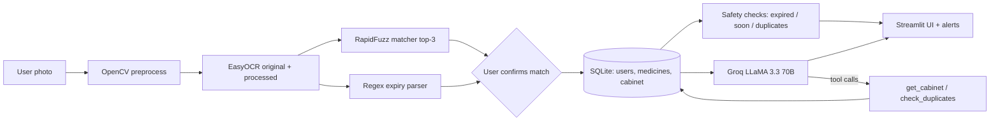

# MediScan AI — Medicine Packaging Recognition and Safety Assistant

> **Educational information only. Not medical advice. Always consult a pharmacist or doctor.**

## Overview
MediScan AI is an AI-agent capstone project. A user photographs a medicine box or strip; the app reads the
text with OCR, matches it to a medicines knowledge base, extracts the expiry date, stores the item in a
personal "medicine cabinet", runs safety checks (expired, expiring soon, shared active ingredients) and
explains medicines in English, Urdu or Roman Urdu with a Groq LLaMA 3.3 70B model that is **grounded only in
the retrieved database record**.

## The agent loop (Perceive → Remember → Reason → Act)
| Stage | What happens | Code |
|---|---|---|
| **Perceive** | Photo → OpenCV (resize, denoise, deskew, adaptive threshold) → EasyOCR on original + processed image, merged | `src/vision/` |
| **Remember** | SQLite per-user cabinet: scans, matched medicine, confidence, expiry date, status | `src/database/` |
| **Reason** | RapidFuzz matching (top-3 + confidence), regex expiry parsing, expiry and duplicate-ingredient checks | `src/matching/`, `src/safety/` |
| **Act** | Grounded LLM explanation, tool-calling assistant (`get_cabinet`, `check_duplicates`), colour-coded alerts | `src/ai/`, `streamlit_app/` |

## Architecture


## Features
- Upload or camera input; shows the preprocessed image, raw OCR lines with confidence and the top-3 matches.
- The user **must confirm** a match before anything is saved (nothing is auto-selected); manual search and manual expiry override.
- Cabinet table with filters, delete, mark as used up; dashboard with Plotly chart and recent scans.
- Safety page with green (OK) / amber (expiring soon) / red (expired) status colours.
- Grounded explanations in English, Urdu and Roman Urdu; chat assistant using Groq tool calling with a plain-prompt fallback.
- Works without an API key: scan, match, cabinet and safety checks stay available; AI parts show a clear "disabled" message.

## Tech stack
Python 3.10+, Streamlit, Plotly, Pandas, NumPy, OpenCV (headless), Pillow, EasyOCR, RapidFuzz, SQLite, Groq SDK, python-dotenv, pytest. Deployment: Docker on Hugging Face Spaces.

## Setup (local)
```bash
python -m venv .venv && source .venv/bin/activate      # Windows: .venv\Scripts\activate
pip install -r requirements.txt                         # CPU torch: pip install torch torchvision --index-url https://download.pytorch.org/whl/cpu
cp .env.example .env                                    # then set GROQ_API_KEY (optional)
streamlit run app.py
pytest                                                  # 100% offline, no network
```
The database (`data/mediscan.db`) is created and seeded on first run and a demo user is added. Use **Continue as Demo User** on the Account page. EasyOCR downloads its English model on first use (about 100 MB).

## Docker and Hugging Face Spaces deployment
```bash
docker build -t mediscan-ai .
docker run -p 7860:7860 -e GROQ_API_KEY=your_key mediscan-ai     # open http://localhost:7860
```
1. Create a new Space on huggingface.co → SDK **Docker** (blank template).
2. Push this repository to the Space (the YAML header at the top of this README sets `sdk: docker` and `app_port: 7860`).
3. In **Settings → Variables and secrets**, add a secret named `GROQ_API_KEY`.
4. The first build downloads the EasyOCR models; later starts are fast.

Note: SQLite data on a free Space is ephemeral and is lost on restart; attach persistent storage and set `MEDISCAN_DB_PATH=/data/mediscan.db` to keep it.

## Safety design
1. The LLM may answer **only** from the retrieved database record or tool results; otherwise it says so and refers the user to the leaflet, a pharmacist or a doctor.
2. No dosing, diagnosis, "take X with Y" or treatment advice. This is enforced twice: in the system prompts and by a deterministic guard (`screen_user_question`) that refuses such questions *before* any LLM call. The seed data contains no dosing text (checked by a test).
3. OCR text and match confidence are always shown. Below the threshold (80%) the app asks the user to choose from the top-3 or search manually; the radio starts with nothing selected.
4. A disclaimer banner is rendered on every page.
5. Duplicate-ingredient wording is fixed: "These products may contain the same active ingredient. Check with a pharmacist." — no dosing or safety verdicts.
6. Without `GROQ_API_KEY` everything non-AI keeps working.
7. Tool calls always use the signed-in user's id, whatever id the model supplies; passwords are stored as salted PBKDF2-HMAC-SHA256 hashes.

## Defaults chosen where the brief was open
Match threshold 80%; "expiring soon" = 60 days; expiry parsed to the last day of the month (an explicit day, e.g. 15/03/2027, is kept); the demo user has no usable password and comes with 5 sample cabinet items; seed data covers 60 medicines with composition left generic where not certain ("Check pack for strength").

## Limitations
- The 60-medicine seed database is small, conservative and **not verified**; every record is tagged "seed - verify against official leaflet". Brands and compositions vary by market and over time.
- OCR accuracy depends on photo quality; curved blister foil and glossy boxes are hard. Only English text is read.
- Matching covers brand/generic names only; unknown medicines must be added to the database.
- Expiry parsing is heuristic; always check the printed date yourself.
- Shared-ingredient detection compares ingredient names only, not strengths or formulations.
- Not a medical device; it gives no medical advice.

## Future work
Larger, pharmacist-reviewed knowledge base; barcode/DataMatrix scanning; Urdu OCR; reminders by email or SMS; user-added medicines; multi-profile family cabinets; evaluation on a labelled photo set.

